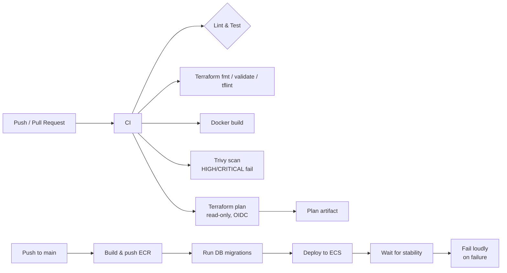

# CI/CD

CocktailDB uses GitHub Actions for continuous integration and continuous deployment. The pipeline is split into three workflows:

1. **`ci.yml`** — runs on every pull request (lint, test, Terraform checks, tflint, Docker build, Trivy scan).
2. **`terraform-plan.yml`** — runs on every pull request; performs a read-only `terraform plan` using an OIDC role (no static credentials) and uploads the plan as an artifact.
3. **`deploy.yml`** — runs on push to `main`; builds and pushes images to ECR, runs DB migrations, deploys to ECS, and waits for service stability.

## Stage diagram



## Workflows

### `ci.yml` — Pull request checks

| Job | Description |
|-----|-------------|
| `lint` | Runs `ruff check .` across the Python codebase. |
| `test` | Installs dependencies and runs `python manage.py test`. |
| `terraform-check` | Runs `terraform fmt -check -recursive` and `terraform validate` in `./terraform`. |
| `tflint` | Runs `tflint` with the configuration in `terraform/.tflint.hcl`. |
| `docker-build` | Builds the Django and Nginx images (no push) to validate the Dockerfiles. |
| `trivy` | Builds the Django image, pushes it to GHCR, and scans it with Trivy. Fails on `HIGH` or `CRITICAL` findings. Results are uploaded as SARIF. |

### `terraform-plan.yml` — Read-only Terraform plan

Runs on pull requests. Uses `aws-actions/configure-aws-credentials@v4` with `role-to-assume` (an OIDC role, never static keys) to perform a read-only `terraform plan`. The plan is saved as a GitHub Actions artifact and summarized in the step summary.

### `deploy.yml` — Production deployment

Runs on push to `main`. Uses GitHub Environments:

- **`staging`** — build/push and migration steps require manual approval (configured in the GitHub Environments settings).
- **`production`** — the deploy step requires manual approval.

The workflow:

1. Builds and pushes the Django and Nginx images to ECR with both the commit SHA and `latest` tags.
2. Runs DB migrations as a one-off ECS task.
3. Registers a new task definition with the new image tags.
4. Updates the ECS service and polls until `runningCount == desiredCount` (or fails after 15 minutes).
5. Writes a deployment summary to the step summary and fails loudly if the service never stabilizes.

## Environments

| Environment | Approval | Secrets |
|-------------|----------|---------|
| `staging`   | Reviewers | `AWS_ROLE_TO_ASSUME`, `RDS_USERNAME`, `RDS_DB_NAME`, `RDS_HOSTNAME` |
| `production` | Reviewers | Same as staging |

## OIDC role

No static AWS credentials are stored in the repository. Instead, GitHub Actions assumes an IAM role via OpenID Connect. The Terraform snippet that creates this role is in `terraform/iam_oidc_role.tf`. It restricts the role to this repository and branch, and grants least-privilege permissions for ECR, ECS, S3 state, and Secrets Manager.

## Badges

The README includes a status badge for the `deploy.yml` workflow:

```

```